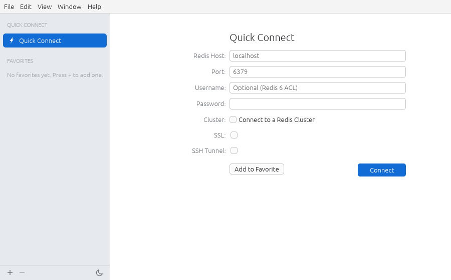
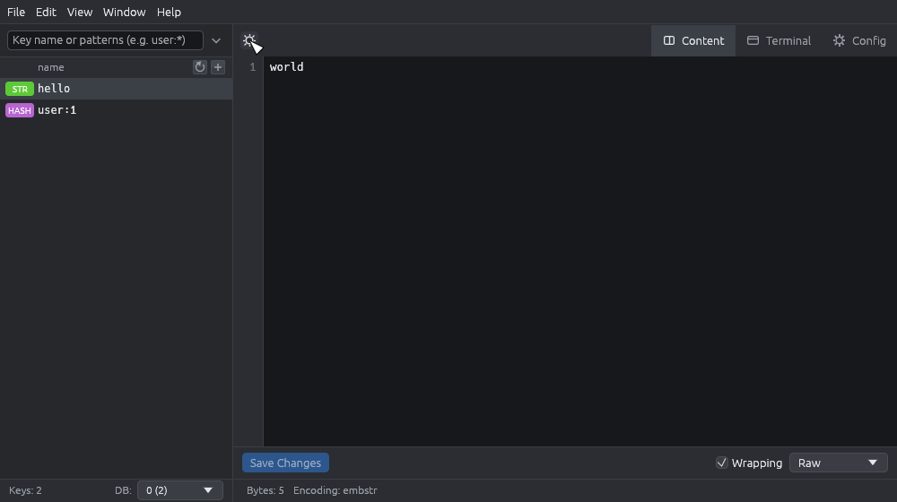

# Medis (Rust)

A fast, native Redis GUI for macOS, Windows and Linux. A Rust port of
[Medis](https://github.com/luin/medis), built with [egui](https://github.com/emilk/egui).




## Download

Grab the latest build from [Releases](https://github.com/hf16136/medis-rs/releases/latest):

| Platform | File |
|---|---|
| Windows (64-bit) | `Medis-<version>-windows-x86_64.zip`: unzip and run `medis.exe` |
| macOS, Apple Silicon (M1 and later) | `Medis-<version>-macos-arm64.dmg` |
| macOS, Intel | `Medis-<version>-macos-x86_64.dmg` |
| Linux (x86_64) | `Medis-<version>-linux-x86_64.tar.gz`: extract and run `./medis` |

The macOS builds are not notarized yet. The first time, right-click **Medis.app** and choose
**Open**, or run:

```sh
xattr -dr com.apple.quarantine /Applications/Medis.app
```

## Features

- **Connections**: host/port, username + password (Redis 6 ACL), SSL/TLS (custom CA, client
  certificates, skip verification), SSH tunnels (password or private key), and Redis Cluster.
- **Favorites** to save connections, plus Quick Connect.
- **Key browser** with pattern filtering, saved patterns, database switching, and type badges.
- **Editors** for strings, hashes, lists, sets and sorted sets, with JSON and MessagePack
  formatting for values.
- **Key operations**: add, rename, duplicate, delete and set expiration.
- **Terminal** tab for running Redis commands, and a **Config** tab for server settings.
- Several connections at once, in tabs or windows.
- Light and dark themes: use the sun/moon button, or **View → Appearance** to follow the system.

## Build from source

Requires Rust 1.95 or newer.

```sh
cargo run --release -p medis-app
```

On Linux you may need the windowing development packages first (Debian/Ubuntu):

```sh
sudo apt install libxkbcommon-dev libwayland-dev libgl1-mesa-dev libx11-dev libxcursor-dev libxrandr-dev libxi-dev
```

To make a macOS `.app` and `.dmg`, see [packaging/README.md](packaging/README.md).

### Tests

```sh
cargo test --workspace
```

The integration and GUI tests that need a server run only when `MEDIS_TEST_REDIS` is set, for
example `MEDIS_TEST_REDIS=redis://127.0.0.1:6379`.

## Project layout

| Path | What's there |
|---|---|
| `crates/medis-core` | Connections, SSH tunnels, scanning and Redis operations. No UI code. |
| `crates/medis-app` | The egui desktop app (`medis` binary). |
| `docs/` | Behaviour specs and design notes for the port. |
| `packaging/`, `scripts/` | macOS packaging. |

## Releasing

Push a version tag. GitHub Actions builds all four packages and publishes the release:

```sh
git tag v0.2.0 && git push origin v0.2.0
```

Bump `version` in the root `Cargo.toml` first so the file names match the tag.

## License

MIT
